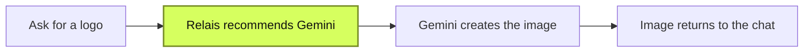

  

  <strong>I'm Mikael, a software engineering student at Epitech.</strong> 
  I build tools that take a task from the first input to a result people can use.

  

  <a href="#relais--the-bridge-between-ai-services">Featured project</a> ·
  <a href="#more-projects">More projects</a> ·
  <a href="https://vyfz.online">Portfolio</a>

## Relais · The bridge between AI services

**A portable Windows app that lets multiple AI services work together in a single conversation.**

Ask for a logo. Relais can recommend Gemini, explain why, and bring the generated image back into the chat. The same bridge can delegate research to Perplexity or ask ChatGPT and Grok for a second opinion. You can approve the recommendation or let Claude route the request automatically.

<table>
  <tr>
    <th width="50%">Choose the AI service</th>
    <th width="50%">See the result in the conversation</th>
  </tr>
  <tr>
    <td width="50%">
      
    </td>
    <td width="50%">
      
    </td>
  </tr>
</table>

Relais brings command-line tools, APIs, and local models into one interface. A Node.js server streams updates to the desktop UI, hosted by a C# launcher using WebView2.

[Explore the repository](https://github.com/Underspace1/relais) · [See the bridge in action](https://github.com/Underspace1/relais#le-pont-entre-les-ia) · [Read the architecture](https://github.com/Underspace1/relais#structure)

## More projects

<table>
  <tr>
    <th width="50%">Dancing!</th>
    <th width="50%">Romega</th>
  </tr>
  <tr>
    <td width="50%" valign="top">
      
      
<strong>Replay-to-video editor</strong>

      
Customize the overlays, preview a clip, and export the replay. One drawing engine keeps the overlay synchronized frame by frame before FFmpeg composes the video.

      <a href="https://github.com/Underspace1/Dancing">GitHub repository</a> ·
      <a href="https://github.com/Underspace1/Dancing/blob/main/docs/TECHNIQUE.md">Technical docs</a>
    </td>
    <td width="50%" valign="top">
      
      
<strong>Website and announcement platform</strong>

      
A responsive site for a Roblox launcher, with an admin interface and a tested Python API that publishes announcements to the launcher through a JSON feed.

      <a href="https://romega.online">Live site</a> ·
      <a href="https://github.com/Underspace1/Romegaweb">Web repository</a>
    </td>
  </tr>
</table>

## Programming languages

| Language | How I use it |
| --- | --- |
| **JavaScript** | Interfaces, local servers, and video rendering logic |
| **TypeScript** | Typed application development |
| **Python** | Web APIs and backend tests |
| **C#** | Windows desktop development |
| **C++** and **Bash** | Programming and scripting |

I use **HTML** and **CSS** for responsive web interfaces.

## GitHub activity

  

---

  For questions about my projects or software engineering opportunities, <a href="https://vyfz.online">get in touch through my portfolio</a>.

