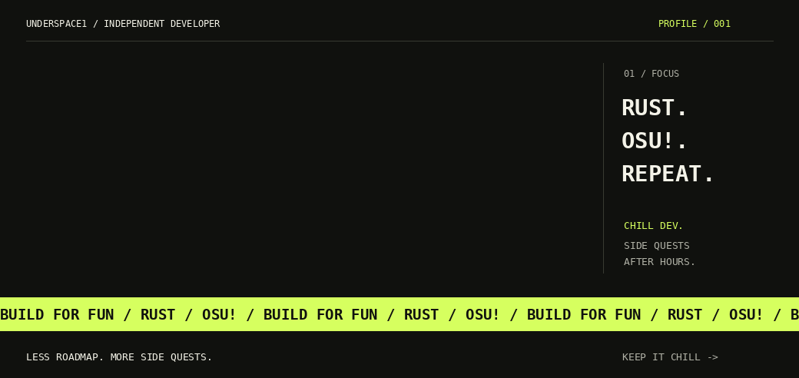
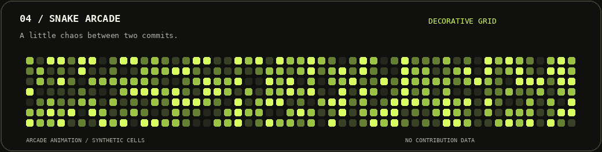
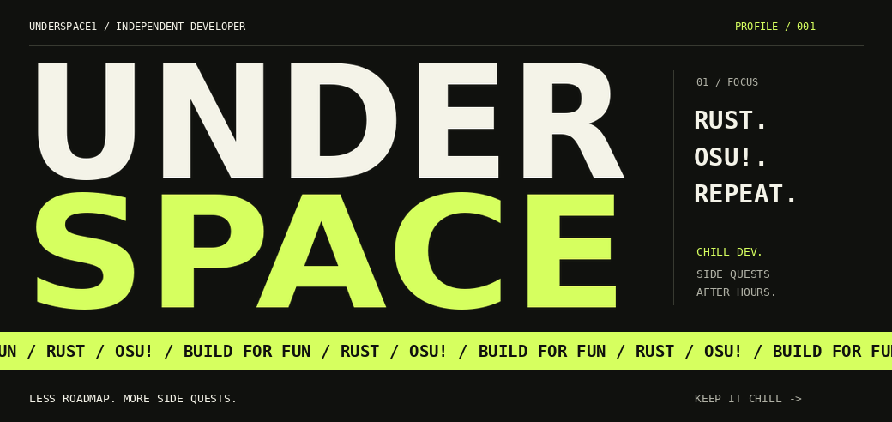
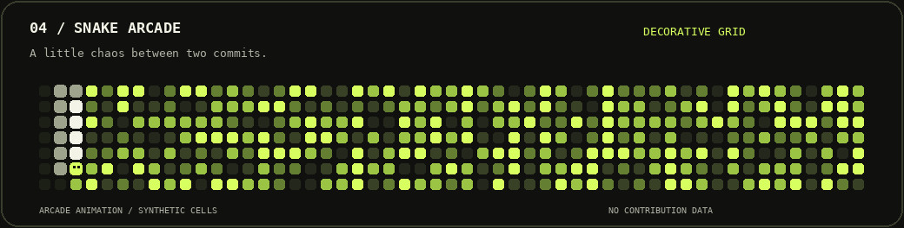

<p align="center">
  
</p>

<p align="center">
  <a href="https://github.com/Underspace1?tab=repositories"></a>
  <a href="https://github.com/Underspace1/osu-collect"></a>
</p>

### 01 / Behind the handle

Chill dev. Rust enthusiast. Probably testing something against **osu!**.
I build things when the idea is fun — usually with lo-fi in one tab and docs in the other.

```rust
let developer = "Underspace";
let current_quest = "osu-collect";
let approach = ["experiment", "learn", "iterate"];
// Permanent work in progress. Enjoy the process.
```

<p align="center">
  
</p>

### 02 / Side quests

| Project | What lives here |
| :--- | :--- |
| **[osu-collect](https://github.com/Underspace1/osu-collect)** | A Rust tool for managing and organizing osu! collections. |
| **[Romegaweb](https://github.com/Underspace1/Romegaweb)** | My HTML corner of GitHub. |

### 03 / Keep the streak alive

<p align="center">
  <a href="https://github.com/Underspace1?tab=overview">
    
  </a>
</p>

<p align="center"><sub>Live GitHub activity · Click the card to open my profile.</sub></p>

### 04 / One more round

<p align="center">
  
</p>

<p align="center"><sub>Arcade mode · Synthetic grid, just for the animation.</sub></p>

<details>
<summary>Still mode — static versions of the animations</summary>




</details>

---

<p align="center">
  <strong>Got an idea? Found a bug?</strong><br />
  <a href="https://github.com/Underspace1/osu-collect/issues">Open an issue on osu-collect</a> · <a href="https://github.com/Underspace1?tab=repositories">Browse my projects</a><br /><br />
  <sub>Stay curious. Keep it chill. Build something fun.</sub>
</p>
