<a href="https://vyfz.online">
  
</a>

<p align="center">
  <a href="https://vyfz.online"></a>
  <a href="https://www.epitech.eu/"></a>
  <a href="https://discord.com/users/778123031763353611"></a>
  <a href="mailto:mikaelroca8@gmail.com"></a>
</p>

<br />

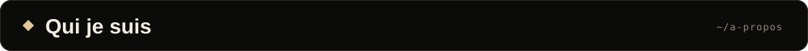

Je m'appelle **Mikael**, alias **Underspace**. J'ai 18 ans et je suis en **1re année du Programme Grande École d'Epitech Paris**.

Je suis encore débutant en programmation : j'apprends en ce moment les bases du **C** et des systèmes **Unix**. À côté, je construis les outils dont j'ai besoin (apps de bureau, outils en ligne de commande, sites web) en travaillant avec l'**IA**, puis je les publie ici.

```c
// underspace.c
const char *nom        = "Mikael";
const char *ecole      = "Epitech Paris, 1re année";
const char *apprend    = "le C et Unix";
const char *point_fort = "l'IA : Claude Code, agents, MCP, API";
const char *passions[] = { "tennis", "gaming", "code" };
```

<br />

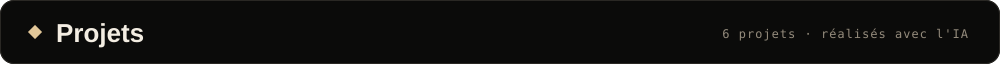

<a href="https://github.com/Underspace1/relais">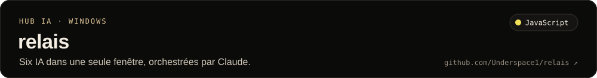</a>

<table>
  <tr>
    <td width="50%"></td>
    <td width="50%"></td>
  </tr>
</table>

Claude, ChatGPT, Grok, Gemini, Perplexity et une IA locale réunis dans une seule fenêtre. Claude joue le chef d'orchestre : il confie chaque demande à l'IA la plus adaptée et peut coder directement dans tes projets.

<br />

<a href="https://github.com/Underspace1/tiroir">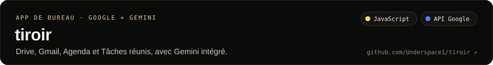</a>

<table>
  <tr>
    <td width="50%"></td>
    <td width="50%"></td>
  </tr>
</table>

Une app de bureau pour Google Drive, Gmail, Agenda et Tâches, avec l'assistant Gemini branché dessus. Aucun serveur intermédiaire : les données vont directement du PC à Google.

<br />

<a href="https://github.com/Underspace1/Dancing">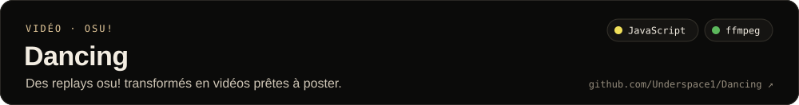</a>

<table>
  <tr>
    <td width="50%"></td>
    <td width="50%"></td>
  </tr>
</table>

Overlay animé synchronisé à l'image, intro, écran de fin, widgets tosu et mises à jour automatiques. L'installeur fournit tout : Node, ffmpeg et tosu.

<br />

<a href="https://github.com/Underspace1/osu-collect">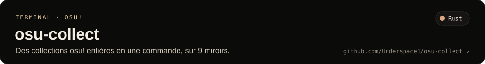</a>

<table>
  <tr>
    <td width="50%"></td>
    <td width="50%"></td>
  </tr>
</table>

Une application terminal qui télécharge les collections d'osu!collector. Les 9 miroirs tournent, avec bascule automatique si l'un tombe, et l'export `collection.db` s'importe directement dans osu!.

<br />

<a href="https://romega.online">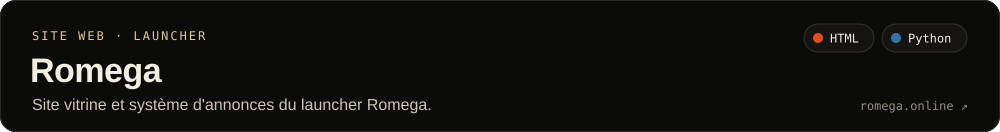</a>

<table>
  <tr>
    <td width="50%"></td>
    <td width="50%"></td>
  </tr>
</table>

Front HTML, CSS et JS sans framework, API Python sous systemd et tests du back-office. Code source : [Romegaweb](https://github.com/Underspace1/Romegaweb).

<br />

<a href="https://vyfz.online">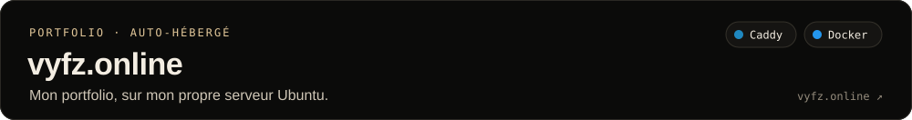</a>

Mon portfolio, hébergé sur mon VPS à côté de mes autres services. Il affiche en direct mes dépôts GitHub et mon statut Discord.

<br />

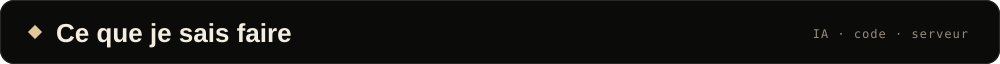

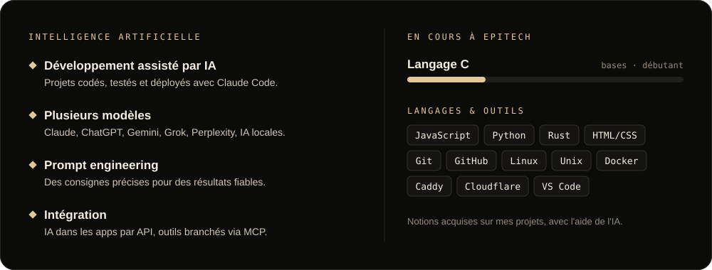

<br />

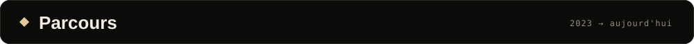


<br />

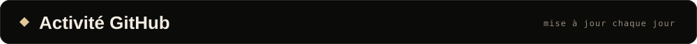

<p align="center">
  <a href="https://github.com/Underspace1?tab=overview">
    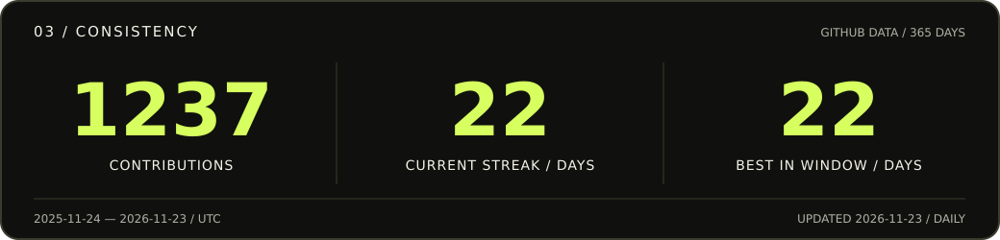
  </a>
</p>

<p align="center">
  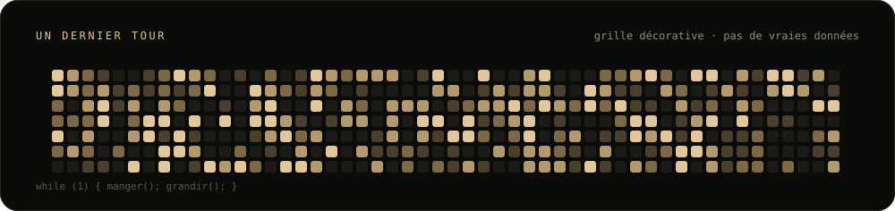
</p>

<br />

<a href="https://vyfz.online">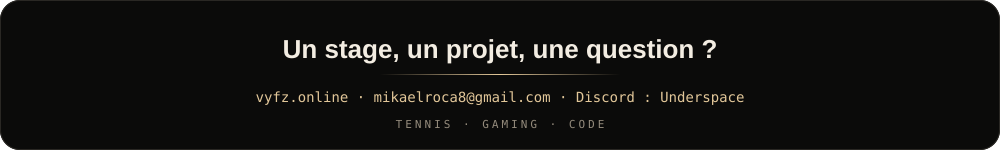</a>
